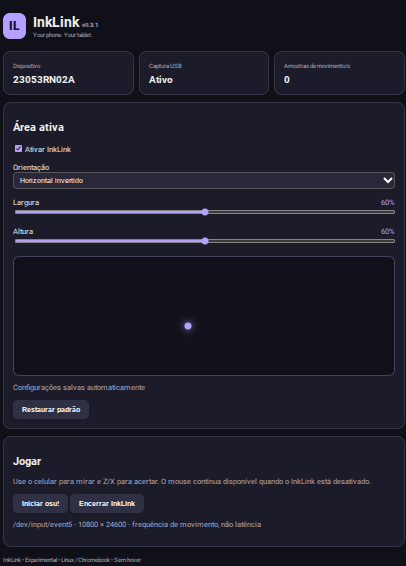
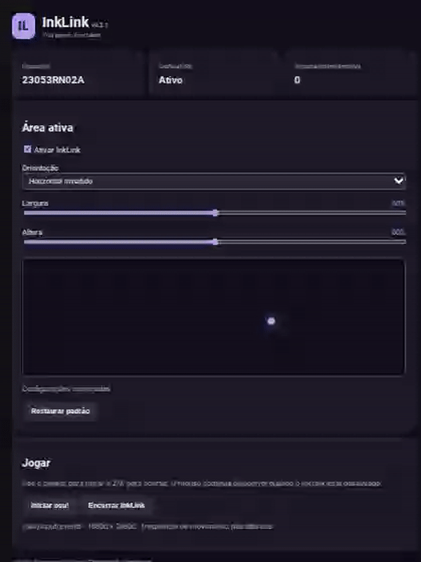

# InkLink

**Your phone. Your tablet. Your freedom.**

> O InkLink nasceu da simples ideia de que criatividade e diversão não deveriam depender de quanto dinheiro você tem.

[English](README.md)

Transforme a tela do Android em um dispositivo de mira absoluta via USB para o wosu!, cliente não oficial de osu! no navegador. O projeto nasceu da vontade de um estudante de voltar a jogar sem comprar uma mesa digitalizadora. Desenvolvido com auxílio de IA e testes práticos.

## v0.3.1 experimental

Detecção automática do touchscreen, ajuste de orientação e área ativa, salvamento de configurações e painel local que inicia o jogo sob demanda. A mira é manual, com Z/X para acertar as notas.

## Interface

## Demonstração em tempo real

## Instalação

Testado em Chromebook com Linux Debian (Crostini) e Redmi Note 12 4G. Outros aparelhos ainda não foram validados. Requer Python 3, Git, ADB, Node.js 22 ou superior e npm; internet para instalação inicial. Leia o instalador antes de executar: usa sudo para ADB e pacotes, clona o wosu! e instala dependências npm. Execute como usuário normal. Caso necessário, instale Node.js 22+ de uma fonte confiável previamente.

1. Ative a depuração USB no Android, conecte um cabo de dados e compartilhe o dispositivo com Linux no ChromeOS. Autorize a depuração no telefone.
2. Baixe e extraia o repositório, abra o terminal na pasta e execute `bash install.sh`.
3. Abra http://localhost:8765 caso o painel não abra sozinho. Ajuste a área ativa e clique em **Iniciar osu!**. O jogo abre em http://localhost:5173.
4. Encerre pelo painel ou Ctrl+C e desative a depuração USB quando terminar.

## Limitações

Sem hover, pressão real de caneta, controle do cursor do sistema, suporte ao Windows ou programas de desenho. Use em partidas privadas/offline; compatibilidade competitiva não verificada. Amostras/s não medem latência total. O instalador fixa o wosu! no commit `12a2bac0389c0b69287c949abb6ca8e89133ba0a`, base testada na v0.3. A candidata v0.3.1 ainda requer validação em hardware. Baixar músicas pode exigir internet.

## Créditos

[wosu!](https://github.com/Mostlime12195/wosu), de Mostlime12195: código MIT, recursos de mídia com licenças próprias. Não distribuímos sua árvore de código ou mídias; o instalador baixa o projeto original e aplica alterações locais. osu! é marca da ppy Pty Ltd. InkLink não é afiliado a esses projetos.

O código próprio do InkLink usa a licença MIT; consulte LICENSE. Consulte THIRD_PARTY.md. Ao relatar bugs, remova números de série e dados pessoais dos logs.

